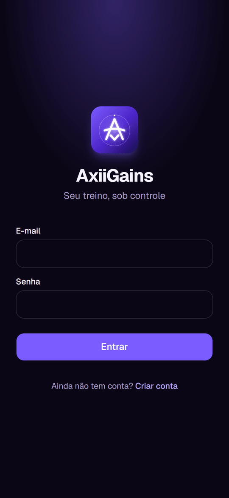
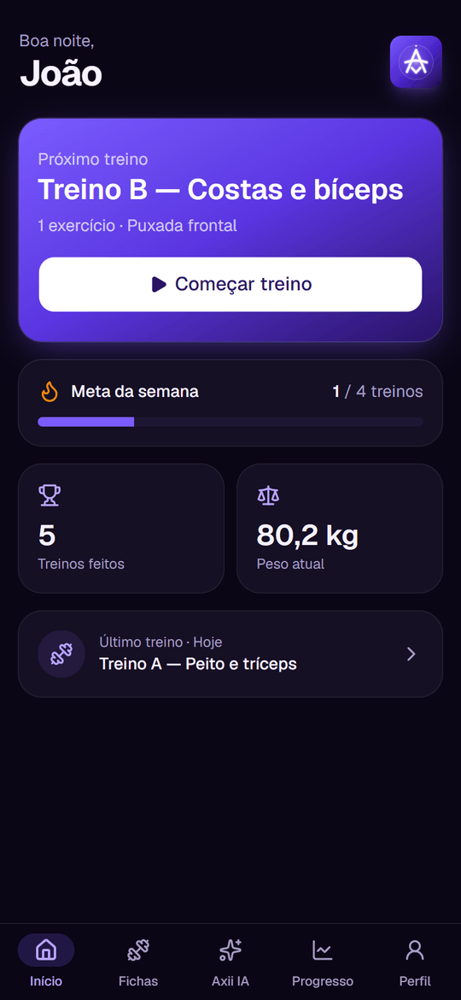
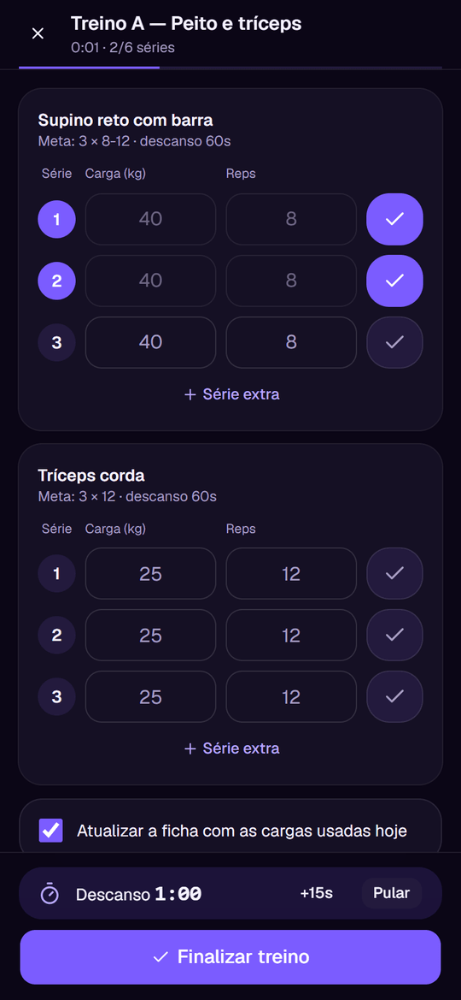
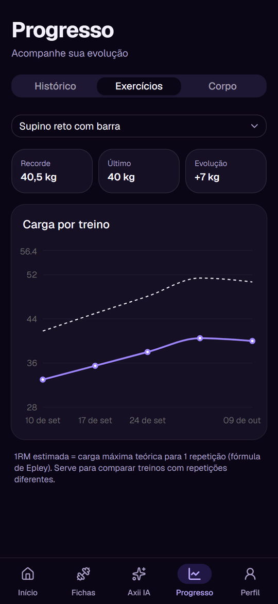
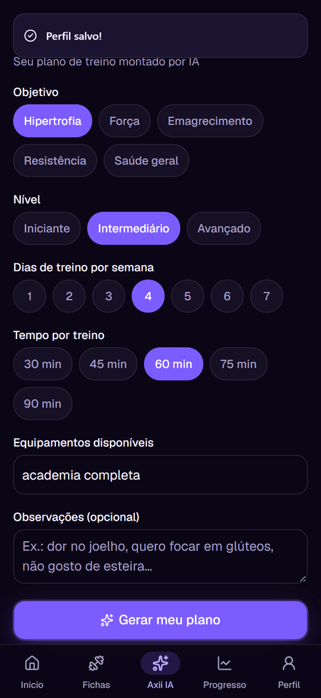

<p align="center">
  
</p>

<h1 align="center">AxiiGains</h1>

<p align="center">
  App de treinos de academia com plano gerado por IA.<br />
  PWA instalável no iPhone e no Android.
</p>

<p align="center">
  
  
  
  
  
</p>

## Funcionalidades

- **Fichas de treino:** exercícios com séries, repetições, carga e descanso.
- **Modo treino:** registro série a série, com cronômetro de descanso. O progresso é salvo automaticamente se o app fechar.
- **Progresso:** histórico de treinos, evolução de carga por exercício (com 1RM estimada) e medidas corporais.
- **Axii IA:** o Gemini monta um plano personalizado a partir do objetivo, do nível e dos dias disponíveis, e o plano vira fichas com um toque.
- **App instalável:** ícone, splash screens para iOS e funcionamento em tela cheia.

## Tecnologias

**Backend:** FastAPI · SQLAlchemy · SQLite · JWT · Google Gemini (`google-genai`)<br />
**Frontend:** React · Vite · Tailwind CSS · shadcn/ui · Recharts · vite-plugin-pwa

## Rodando localmente

Requer Python 3.12+ e Node.js 20+.

```bash
# Backend
cd backend
python -m venv venv
venv\Scripts\activate          # Linux/macOS: source venv/bin/activate
pip install -r requirements.txt
cp .env.example .env           # e preencha as variáveis
uvicorn app.main:app --reload
```

```bash
# Frontend (em outro terminal)
cd frontend
npm install
npm run dev
```

O app abre em http://localhost:5173 e a documentação da API em http://localhost:8000/docs.

### Variáveis de ambiente (`backend/.env`)

| Variável | Descrição |
|---|---|
| `SECRET_KEY` | Chave que assina os tokens de login. Gere com `python -c "import secrets; print(secrets.token_urlsafe(48))"` |
| `GEMINI_API_KEY` | Chave da API do Gemini ([obtenha aqui](https://aistudio.google.com/apikey)). Sem ela, o resto do app funciona normalmente |
| `GEMINI_MODEL` | Modelo usado (padrão: `gemini-flash-latest`) |
| `DATA_DIR` | Pasta do banco SQLite (padrão: `backend/`) |

## Deploy

O [`Dockerfile`](Dockerfile) gera o frontend e roda tudo em um único serviço, onde o FastAPI serve a API e o app. Exemplo no [Railway](https://railway.com):

1. Crie um projeto a partir deste repositório. O Dockerfile é detectado automaticamente.
2. Adicione um **Volume** com o *mount path* `/data`. Sem ele, o banco é apagado a cada deploy.
3. Defina as variáveis `SECRET_KEY` e `GEMINI_API_KEY`.
4. Gere um domínio público e abra a URL no celular para instalar o app.

## Estrutura

```
backend/app/
  main.py          # app FastAPI; serve o frontend em produção
  models.py        # tabelas (usuários, fichas, treinos, medidas)
  schemas.py       # validação com Pydantic
  routers/         # auth, plans, sessions, measurements, progress, ai
frontend/src/
  pages/           # telas
  components/      # layout e componentes (ui/ = shadcn)
  context/         # autenticação
  lib/             # cliente da API e utilitários
```

Mais detalhes técnicos, erros comuns e decisões de arquitetura estão em [docs/GUIA.md](docs/GUIA.md).

---

<sub>O nome e o ícone fazem uma homenagem ao sinal Axii da série <i>The Witcher</i>. O projeto não tem afiliação com a CD PROJEKT RED nem com Andrzej Sapkowski.</sub>
